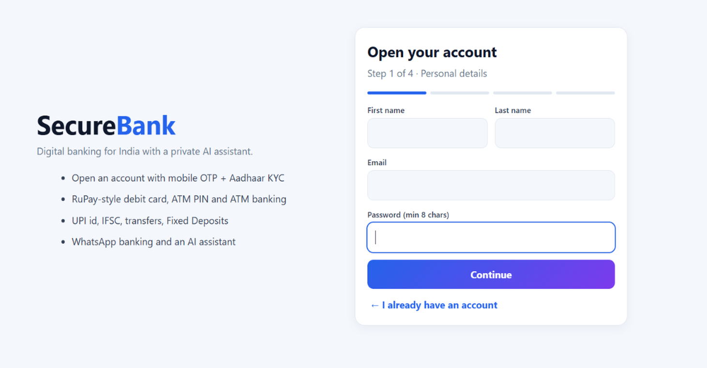
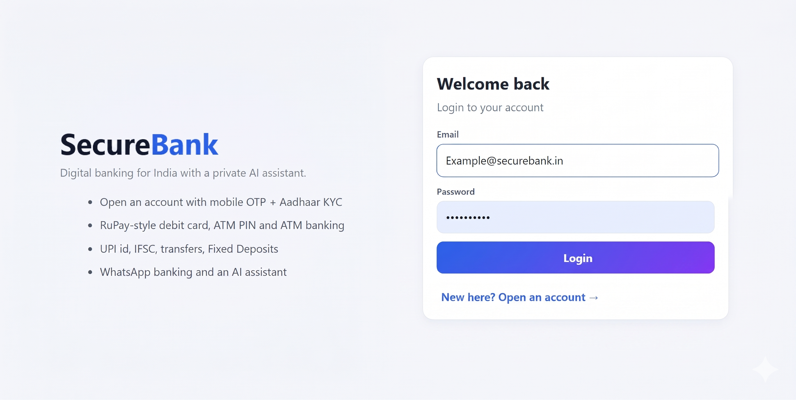
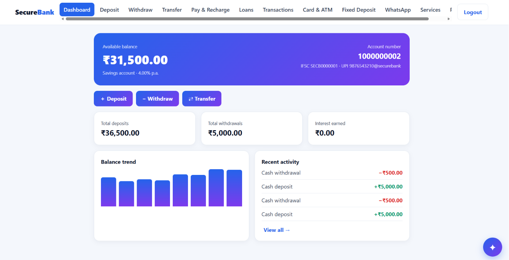
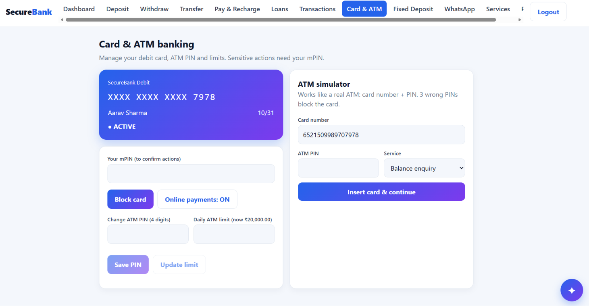
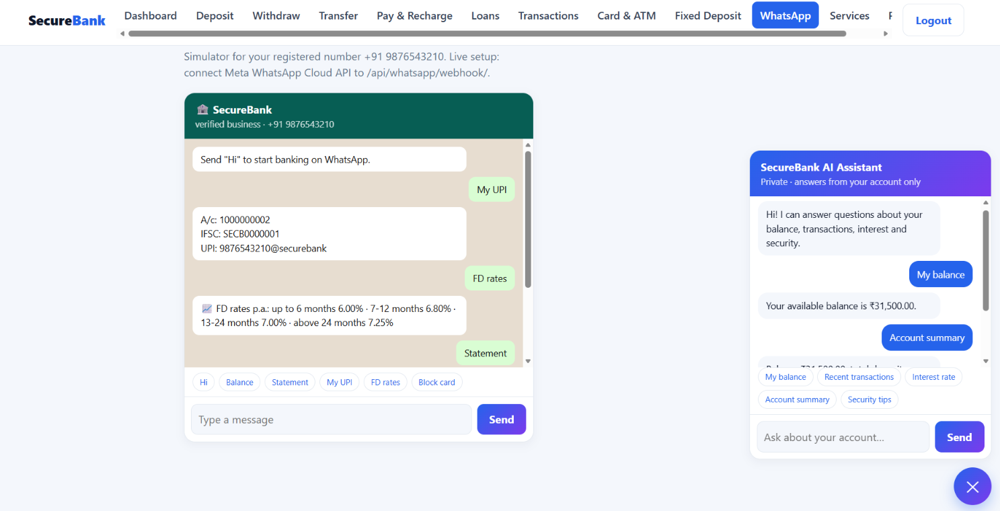
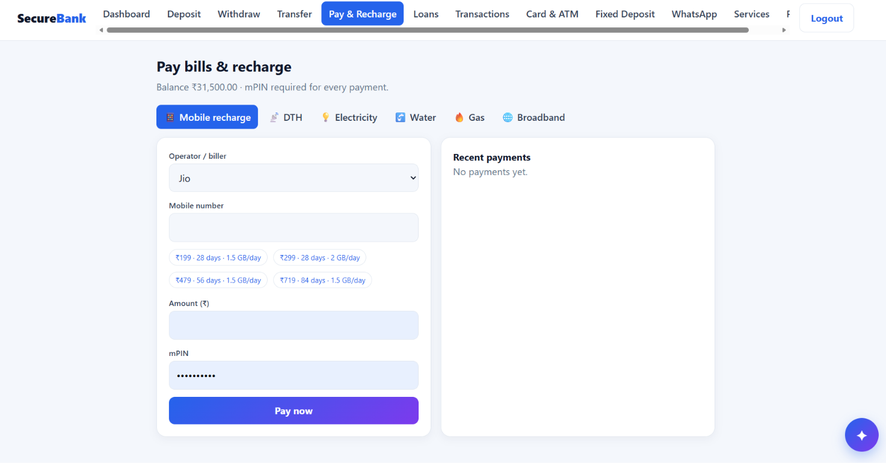

<div align="center">

# 🏦 SecureBank — Full-Stack Indian Banking Simulation System

**A unified full-stack digital banking prototype demonstrating modern Indian banking workflows, role-based administration, ATM simulation, and conversational AI/WhatsApp integration.**


</div>

---

> ### ⚠️ Academic & Legal Disclaimer
> **SecureBank** is strictly an **educational banking simulation** developed for academic demonstration and learning purposes. It is **not** a licensed financial institution or a live banking service:
> - **Aadhaar Validation:** Uses the mathematical **Verhoeff checksum algorithm** for format validation only; it does **not** verify identity with UIDAI or perform biometric authentication.
> - **Card Validation:** Uses the **Luhn algorithm** for format checks only; it does not verify live card issuance.
> - **Fund Transfers & Payments:** All transfers, UPI-like IDs, bill payments, and recharges are simulated internally and do **not** settle through real UPI, NEFT, IMPS, or NPCI networks.
> - **External Integrations:** Live SMS OTPs, AI responses, and WhatsApp messaging require valid third-party provider credentials and configuration.

---

## 📑 Table of Contents

- [Overview](#-overview)
- [Key Modules & Features](#-key-modules--features)
- [System Architecture](#-system-architecture)
- [Technology Stack](#-technology-stack)
- [Project Directory Structure](#-project-directory-structure)
- [Security Design](#-security-design)
- [User & Admin Workflows](#-user--admin-workflows)
- [Local Setup & Installation](#-local-setup--installation)
- [Environment Variables](#-environment-variables)
- [Testing Strategy](#-testing-strategy)
- [Screenshots](#-screenshots)
- [Known Limitations](#-known-limitations)
- [Future Enhancements](#-future-enhancements)
- [Academic & Author Details](#-academic--author-details)

---

## 📌 Overview

Digital banking systems require strict synchronization between user-facing interfaces, server-side validation, database consistency, and access control. Rather than demonstrating isolated features like a standalone login page or a basic balance viewer, **SecureBank** brings core Indian digital banking operations together into one cohesive full-stack application.

Built with a **React** frontend, a **Python/Django** backend, and a relational database (**SQLite** for local development and **PostgreSQL** for deployment), the platform serves as a practical testbed for studying:
- Frontend–backend API communication and separation of concerns
- Relational data modeling and transactional integrity
- Multi-step authentication, OTP safeguards, and Role-Based Access Control (RBAC)
- Administrative review queues and downloadable PDF statements
- Third-party integration boundaries (SMS, Anthropic Claude API, Meta WhatsApp Cloud API)

---

## ✨ Key Modules & Features

### 1. 🔐 Account Opening & Authentication
- Multi-step customer onboarding workflow collecting profile and account-type details.
- Mobile OTP verification flow with configurable expiration and attempt limits.
- Simulated Aadhaar-format/checksum validation (Verhoeff algorithm) and KYC document upload workflow.
- Secure login/logout with server-side session/token validation.

### 2. 💸 Beneficiary Management & Simulated Fund Transfers
- Add, view, and manage saved beneficiaries.
- Execute internal simulated fund transfers with strict backend checks for:
  - Account ownership and active account status
  - Available simulated balance and configured transaction limits
  - Duplicate submission prevention and transaction history recording

### 3. 💳 Debit Card Controls & ATM Simulator
- Virtual debit card management including card variants, CVV reveal controls, transaction limits, and instant card block/unblock toggles.
- Interactive **ATM Simulator** supporting:
  - Balance enquiry
  - Simulated cash withdrawal with daily/per-transaction limit enforcement
  - Mini statement generation
  - ATM PIN change workflow

### 4. 📈 Fixed Deposits & Loan Applications
- **Fixed Deposits (FD):** Interactive deposit creation and illustrative maturity/interest calculations.
- **Loans & EMI Calculator:** Loan application submission, EMI calculation engine, and administrative approval status tracking.

### 5. 🧾 Bill Payments, Recharges & Cheque Book Services
- Sample utility bill payments and mobile/DTH recharge request flows.
- Cheque-book request module with status lifecycle tracking managed via the admin panel.

### 6. 📄 Downloadable Statements & Administrative Dashboard
- **Customer Statements:** Generate and download structured transaction history statements (PDF).
- **Admin Dashboard:** Role-protected control panel allowing authorized administrators to review KYC documents, approve/reject loan and card applications, manage cheque-book dispatches, and freeze/unfreeze customer accounts.

### 7. 🤖 AI Banking Assistant & WhatsApp Integration
- **AI Banking Assistant:** Informational conversational support powered by configurable AI integration points (Anthropic Claude API). Strictly informational—cannot initiate or authorize fund transfers.
- **WhatsApp Banking Integration:** Command-handling endpoints designed for Meta WhatsApp Cloud API (supports local simulation mode; live messaging requires Meta Business setup and webhook verification).

---

## 🏗️ System Architecture

SecureBank follows a layered architecture where all business rules, ownership checks, and state transitions are enforced independently on the backend.

```text
+-----------------------------------------------------------------------+
|                        PRESENTATION LAYER                             |
|              React Frontend / HTML5 / CSS3 / JavaScript               |
|    (Dashboard, Onboarding, Transfers, ATM Simulator, AI Assistant)    |
+-----------------------------------+-----------------------------------+
                                    |  HTTP / REST API (JSON)
                                    v
+-----------------------------------------------------------------------+
|                         APPLICATION LAYER                             |
|                     Python 3.12 + Django 5.2                          |
|  - Authentication & OTP Verification    - Transfer & Limit Engine     |
|  - Server-Side Validation & RBAC        - KYC & Card Controls         |
|  - PDF Statement Generator              - Admin Approval Workflows    |
+-----------------+-----------------------------------+-----------------+
                  |                                   |
        ORM / SQL |                                   | Optional APIs
                  v                                   v
+-----------------------------------+ +---------------------------------+
|            DATA LAYER             | |   OPTIONAL INTEGRATION LAYER    |
|  - SQLite (Local Development)     | |  - SMS Provider (OTP Delivery)  |
|  - PostgreSQL (Deployment)        | |  - Anthropic Claude API (AI)    |
|  - Accounts, Transactions, KYC,   | |  - Meta WhatsApp Cloud API      |
|    Cards, Loans, FDs, Audit Logs  | |  - Redis / Celery (Async Tasks) |
+-----------------------------------+ +---------------------------------+
```

---

## 🛠️ Technology Stack

| Layer | Technologies Used |
| :--- | :--- |
| **Frontend** | React, JavaScript (ES6+), HTML5, CSS3, Node.js / npm |
| **Backend** | Python 3.12, Django 5.2 |
| **Database** | SQLite (Local Development), PostgreSQL (Production / Deployment) |
| **Async / Background Tasks** | Redis, Celery (Optional configuration) |
| **External APIs (Optional)** | SMS Gateway, Anthropic Claude API, Meta WhatsApp Cloud API |
| **Testing & QA** | Django Test Framework (Unit & API Tests), Playwright (End-to-End Browser Tests) |

---

## 📂 Project Directory Structure

```text
SecureBank/
├── backend/
│   ├── accounts/               # User registration, login, profiles, demo seeding
│   ├── ai_assistant/           # AI banking assistant views and routes
│   ├── api/                    # REST API endpoints (KYC, OTP, SMS, PDF statements, features)
│   ├── banking_system/         # Core Django project settings and root URLs
│   ├── services/               # Debit cards, ATM, KYC profiles, cheque books, loans, FDs
│   ├── transactions/           # Deposits, withdrawals, transfers, transaction history & tasks
│   ├── static/                 # CSS & JS assets
│   ├── templates/              # Django HTML templates
│   ├── .env.example            # Sample environment configuration
│   ├── manage.py               # Django CLI utility
│   ├── Procfile                # Deployment process definition
│   ├── requirements.txt        # Python dependencies
│   └── runtime.txt             # Python runtime specification
├── frontend/
│   ├── css/                    # Application stylesheets
│   ├── js/                     # API client and frontend application logic
│   ├── index.html              # Entry point
│   └── build-demo.py           # Demo build script
├── analysis/                   # Survey & project evaluation analysis scripts/templates
├── docs/                       # Setup guides (RUN_IN_VSCODE.md, STEPS.md)
├── run.bat                     # Quick-start launcher for Windows
├── SECURITY_CHANGES.md         # Security implementation notes
└── README.md                   # Project documentation
```

---

## 🔒 Security Design

Security controls are implemented at the server layer because browser-side checks can always be bypassed:

- **Password Hashing:** User passwords are stored using Django's secure password-hashing framework—never in plain text.
- **OTP Safeguards:** Generated OTPs enforce strict expiration windows, maximum verification attempt limits, and immediate invalidation after successful use.
- **Object-Level Authorization:** Every request validates that the authenticated user owns the target account, beneficiary, debit card, transaction, or statement.
- **Role-Based Access Control (RBAC):** Administrative endpoints (KYC approval, loan review, account freeze/unfreeze) strictly enforce administrator role permissions.
- **Checksum Validation:** Verhoeff and Luhn algorithms validate mathematical structure without storing or claiming official government verification.
- **Secret Management:** API keys, database credentials, and provider tokens are loaded via environment variables (`.env`) and excluded from version control via `.gitignore`.

---

## 🔄 User & Admin Workflows

### Customer Workflow
1. Open the registration page and submit basic account details.
2. Complete the configured mobile OTP verification step.
3. Complete simulated Aadhaar-format checks and profile setup.
4. Sign in to access the **Customer Dashboard**.
5. Use banking modules: manage beneficiaries, initiate internal transfers, configure debit card limits, operate the ATM Simulator, open FDs, apply for loans, submit bill/cheque-book requests, or download statements.
6. Track real-time request statuses and transaction logs.

### Administrator Workflow
1. Sign in using an authorized administrator account.
2. Open the **Administrative Dashboard** and review pending queues.
3. Inspect KYC documents, loan applications, card requests, and cheque-book requests.
4. Perform authorized actions (**Approve**, **Reject**, **Dispatch**, **Freeze**, or **Unfreeze**).
5. All state transitions are persisted and reflected immediately in the customer's dashboard.

---

## 🚀 Local Setup & Installation

### Prerequisites
- **Python 3.12+**
- **Node.js & npm** (for frontend tooling)
- **Git**

### 1. Clone the Repository
```bash
git clone [https://github.com/Himanshu1137/SecureBank.git](https://github.com/Himanshu1137/SecureBank.git)
cd SecureBank
```

### 2. Backend Setup (Django)
```bash
cd backend

# Create a virtual environment
python -m venv venv

# Activate virtual environment
# On Windows:
venv\Scripts\activate
# On macOS / Linux:
source venv/bin/activate

# Install Python dependencies
pip install -r requirements.txt

# Create your environment file from the example template
copy .env.example .env      # Windows
# cp .env.example .env      # macOS / Linux

# Apply database migrations
python manage.py migrate

# (Optional) Seed demo data for testing
python manage.py seed_demo

# Create an admin superuser
python manage.py createsuperuser

# Run the Django development server
python manage.py runserver
```

### 3. Frontend Setup
Open a new terminal in the project root:
```bash
cd frontend
# If using npm/React build setup:
npm install
npm start
```
*(Alternatively, on Windows you can inspect and run `run.bat` from the root directory to launch the project quickly.)*

---

## ⚙️ Environment Variables

Configure your `backend/.env` file based on `backend/.env.example`. Never commit your actual `.env` file to GitHub.

```env
# Django Core
SECRET_KEY=your-secret-key-here
DEBUG=True
ALLOWED_HOSTS=127.0.0.1,localhost

# Database (Defaults to SQLite if not set)
DATABASE_URL=

# Optional Third-Party Integrations (Simulated if left blank)
SMS_API_KEY=
ANTHROPIC_API_KEY=
WHATSAPP_API_TOKEN=
WHATSAPP_PHONE_NUMBER_ID=
```

---

## 🧪 Testing Strategy

SecureBank combines multi-layer testing to validate both backend rules and end-to-end user journeys:
- **Unit Tests:** Verify EMI formulas, FD calculations, and Verhoeff/Luhn checksum helpers.
- **API & Security Tests:** Validate input constraints, OTP expiry/attempt limits, account ownership, transfer limits, and admin RBAC restrictions.
- **End-to-End (E2E) Browser Tests:** Playwright scripts covering signup, login, transfers, ATM simulator limits, and statement downloads.

Run backend tests with:
```bash
cd backend
python manage.py test
```
> *Note: External SMS, AI, and WhatsApp integrations run with simulated responses during local automated testing unless live provider credentials are explicitly configured.*

---

## 📸 Screenshots

| Open Your Account | Login Account |
| :---: | :---: |
|  |  |

| Customer Dashboard | Card & ATM |
| :---: | :---: |
|  |  |

| AI & WhatsApp Banking Assistant | Pay & Recharge |
| :---: | :---: |
|  |  |

---

## ⚠️ Known Limitations

- Aadhaar validation verifies mathematical checksum/format only—it does not connect to UIDAI.
- Fund transfers, UPI IDs, and bill payments are simulated and do not settle on real banking networks (UPI/NEFT/IMPS/NPCI).
- Live SMS OTP delivery, AI Assistant responses, and WhatsApp banking require active external provider accounts and valid API credentials.
- Interest rates, card limits, and loan eligibility rules are illustrative demonstration settings.
- The application is not a licensed bank and does not claim regulatory or production banking compliance.

---

## 🔮 Future Enhancements

- Integration with authorized KYC providers and regulated payment/biller sandboxes.
- Enhanced audit logging, centralized monitoring, automated backups, and incident-response workflows.
- ML-based transaction anomaly and fraud detection using lawful synthetic datasets.
- Mobile-first PWA/native app support, accessibility (WCAG) upgrades, and multi-language localization.
- Automated CI/CD pipelines, containerization (Docker), and secret-manager integration.

---

## 👨‍💻 Academic & Author Details

| Field | Details |
| :--- | :--- |
| **Author** | Himanshu Pal |
| **GitHub** | [@Himanshu1137](https://github.com/Himanshu1137) |
| **Degree** | B.Tech in Computer Science and Engineering |
| **Institute** | Maharana Pratap Engineering College, Kanpur |
| **University** | Dr. A.P.J. Abdul Kalam Technical University, Lucknow |
| **Academic Session** | 2026–2027 |

---

<div align="center">
  <sub>Built for academic study and full-stack software engineering demonstration.</sub>
</div>
